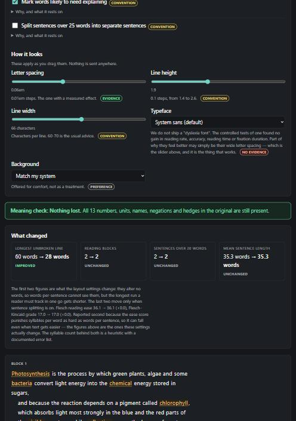

# legible

Restructures lesson material for dyslexic and ADHD readers — and checks that
it kept every number, name, negation and hedge the original had.



```bash
pip install git+https://github.com/Sanixaa23/legible
legible serve
```

No runtime dependencies. Works offline. The text never leaves the machine.

### The one-minute version — with narration

[](https://github.com/Sanixaa23/legible/blob/main/docs/legible-short.mp4)

### ▶ [Watch the 63 seconds, with narration](https://github.com/Sanixaa23/legible/blob/main/docs/legible-short.mp4)

The moving image above is a **silent 11-second preview** — it is a GIF, and a GIF
cannot carry audio. The full video is narrated; click the link above and GitHub
plays it with sound.

Every number in it comes out of `legible` at render time rather than from a
script: `tools/viral_render.py` calls `restructure.build()` on the sample lesson
and draws what comes back, so the sixty words, the twenty-eight and the
thirteen-of-thirteen cannot drift from what the tool actually does. The
narration is synthetic — ElevenLabs, voice "Jessica", model `eleven_v4` — and
the takes are committed in `docs/narration/`, because each scene takes its
length from its own line and a clone needs them to render the same cut.

---

## The problem with tools that make text easier

Making text easier to read means changing it, and changing text changes what
it says. The two failures are specific and they are not rare:

| Original | "Simplified" | What happened |
|---|---|---|
| Antibiotics **do not** work against viruses | Antibiotics work against viruses | A negation vanished |
| The rate **may** fall below 10 degrees | The rate falls below 10 degrees | A hedge became a fact |
| **Only 3** of the **1,200** samples reacted | Some samples reacted | The quantities went |

All three read better than the original. All three are wrong, and a child
studying from them cannot tell. So this tool is built the other way round:
it starts from what must survive, and only then asks what it can change.

## What it does

**By default it changes no words at all.** It changes how the text is laid
out — spacing, line width, paragraph length, one clause per line, which
sentence you see first, which words are worth explaining to the class. Fact
retention on that path is 1.0 by construction, not by measurement: none of
those operations can delete a token, and a test checks every token of the
corpus, in order, to make sure.

Splitting over-long sentences is a separate, opt-in tier. It is still
deterministic, and it still keeps every token: when it breaks a sentence at
*and*, *but* or *so*, the connective starts the new sentence instead of
being dropped.

That leaves exactly one place meaning can be lost, and it is guarded.

The same check runs as a command, and it is worth pointing at text this
program did not produce — a shortened worksheet, or whatever a language
model returned when someone asked it to simplify a lesson:

```
$ cat lesson.txt
Antibiotics do not work against viruses. The rate may fall below 10 degrees Celsius.
$ cat simplified.txt
Antibiotics work against viruses. The rate falls below 10 degrees Celsius.

$ legible check lesson.txt --against simplified.txt
lesson.txt -> simplified.txt: MEANING CHANGED -- lost 2 of 5 (negation: not; modality: may)
  lost negation  not    Losing a negation reverses the claim. This is the most dangerous single failure.
  lost modality  may    'May cause' and 'causes' are different claims. Flattening one overstates the text.
```

Exit code 1, so it works in a marking pipeline, over a folder of
worksheets, or in front of whatever produced the rewrite.

Without `--against` it checks our own output and reports what it watched:

```
$ legible check corpus/01_biology_photosynthesis.txt
corpus/01_biology_photosynthesis.txt: all 15 checked items kept
```

That one cannot fail, and the reason is the design rather than a weak
check: the pipeline discards a losing rewrite before anything downstream
sees it. `test_cli.py` asserts both halves — that `--against` catches the
transcript above, and that every corpus file passes the plain form through
both tiers. If the plain form ever exits 1, the fail-closed fallback has
broken.

## Measured fact retention

```
FACT RETENTION                  items  layout  rewrite   sentences   ease
-----------------------------------------------------------------------------
01_biology_photosynthesis.txt     15    1.00     1.00     4 -> 8    +20.9
02_history_industrial.txt         28    1.00     1.00     3 -> 6    +21.8
03_physics_forces.txt             18    1.00     1.00     7 -> 9     +5.1
04_chemistry_reactions.txt         9    1.00     1.00     6 -> 9     +9.0
05_geography_water.txt            18    1.00     1.00     5 -> 9    +13.7
06_adversarial_negation.txt       27    1.00     1.00     7 -> 11    +8.1
90_control_already_simple.txt      8    1.00     1.00     8 -> 8     +0.0
91_control_two_sentences.txt       5    1.00     1.00     2 -> 2     +0.0
-----------------------------------------------------------------------------
256 of 256 checked items kept across 8 files, both tiers (100.0%)
```

`python tests/test_retention.py` prints this. Two things make it worth
reading rather than skipping:

- **`06_adversarial_negation.txt` is built to break the tool.** Every
  paragraph's meaning lives in a negation or a hedge — *do not work*, *will
  not shorten*, *rarely*, *the risk is not zero*, *does not imply*, *is not
  weight*. 10 negations and 9 hedges, and a test asserts they are still
  there, so the retention table cannot pass by having nothing to lose.
- **The last two rows are negative controls.** Text that was already simple,
  and text too short to restructure. Both must come out unchanged, and the
  `+0.0` is the number that proves the tool is not inventing improvements.

CI also runs `tools/gate_demo.py`, which feeds the check four rewrites that
lie and fails the build if it does not catch all four. A green suite that
cannot go red proves nothing.

## Every setting says how well it is supported

This is the part no other tool in this space does, and it came out of
reading the research before writing the code.

| Setting | Tier | Rests on |
|---|---|---|
| Wider letter spacing | **Measured effect** | Zorzi et al. (2012), PNAS 109(28):11455–11459 |
| Key sentence first | Some evidence | Advance-organiser and signalling literature |
| Line width 60–70 characters | Convention | BDA Dyslexia Style Guide |
| Shorter sentences | Convention | BDA; Dyslexia Scotland |
| Shorter paragraphs | Convention | Plain-language guidance |
| Coloured background | Reader preference | Comfort, no reading-rate effect |
| **A "dyslexia font"** | **No measured benefit** | Rello & Baeza-Yates (2013); Wery & Diliberto (2016); Kuster et al. (2018) |

Nearly every tool for dyslexic readers leads with a dyslexia font. The
controlled tests found no improvement in reading rate or accuracy, no
improvement in reading time or fixation duration, and no reader preference;
a review concluded there is no evidence these fonts improve reading
performance.

Meanwhile letter spacing — where 74 diagnosed children roughly doubled
reading accuracy and gained about 20% in speed, with no training — is the
setting almost nobody surfaces. So it is the first control on the page, and
the font we do not ship is explained where a teacher will read it.

`legible evidence` prints the whole register with sources. `test_safety.py`
holds it in place: if someone promotes the font entry to a stronger tier,
they have to delete a test and explain why in the diff.

> **Not a diagnosis, an assessment or a treatment.** It restructures text.
> A tier is not a promise about any one reader — Zorzi et al. found the
> benefit was largest for the children who were worst at identifying
> letters, so it was not uniform.

## Using it

```bash
legible serve                      # the reading view, at 127.0.0.1:8000
legible read lesson.txt            # restructured, in the terminal
legible read lesson.txt --rewrite  # also split sentences over 25 words
legible read lesson.txt --html     # the whole page, to a file
legible check lesson.txt           # what the meaning check is watching
legible check a.txt --against b.txt  # exit 1 if b.txt lost any of it
legible stats lesson.txt           # the numbers only
legible evidence                   # what each setting rests on
legible read lesson.pdf            # needs: pip install "legible[pdf]"
```

Turn settings off by name: `legible read lesson.txt --off anchor --off chunk`.

There is a JSON API on the same server for anyone wiring this into a
worksheet pipeline:

```bash
curl -s -X POST http://127.0.0.1:8000/api/restructure \
  -H 'Content-Type: application/json' \
  -d '{"text":"...","settings":{"split_sentences":true}}'
```

## How it is built

Five modules, and the boundaries between them are the design:

| Module | Job |
|---|---|
| [`evidence.py`](src/legible/evidence.py) | The register: every claim, its tier, its source |
| [`readability.py`](src/legible/readability.py) | Deterministic measurement. No model, no network, no randomness |
| [`facts.py`](src/legible/facts.py) | What a rewrite is not allowed to lose, and the retention check |
| [`transform.py`](src/legible/transform.py) | The operations, in two tiers, each declaring its evidence key |
| [`restructure.py`](src/legible/restructure.py) | The pipeline, which fails closed |

The pipeline order is fixed: measure, rewrite if asked, **check retention
immediately**, discard the rewrite if anything was lost, lay out what
survived, measure again. The only step that can fail falls back to the
author's own sentence. The failure mode of this program is "this paragraph
is harder than it could be", never "this paragraph says something the lesson
did not".

No language model makes any decision here. There is no LLM in the default
path at all.

## What the corpus taught us

Every one of these came from running the code on real lesson text and
watching it be wrong. Each is now a test.

1. **A name that moves to the start of a sentence looks like a deleted
   name.** Splitting *"...and Dr. Smith recorded it"* gives *"Dr. Smith
   recorded it"*, where the position-based name rule no longer fires, and
   the check reported a loss that never happened. Names are now collected
   strictly on the original and leniently on the rewrite.

2. **Expanding a contraction looked like losing a negation.** *"doesn't"*
   normalised to its own token, so rewriting it as *"does not"* was
   refused. Contracted auxiliaries now collapse to the negation they carry
   — and `nobody` deliberately does not, because it carries more than one.

3. **`, and` does not always join two clauses.** In *"it has two stages: the
   light-dependent stage, which..., and the light-independent stage,
   which..."* the splitter handed a child a noun phrase with no main verb
   and called it a sentence. Two shape rules now decline that break.

4. **Flesch reading ease can fall when text gets easier.** It punishes
   syllables per word as hard as words per sentence, so deleting short
   function words shortens the sentence and raises syllable density at the
   same time. This is why ease is reported second, and one more reason the
   default path deletes nothing.

5. **The layout tier was invisible to every statistic we had.** It changes
   no words, so words-per-sentence is identical before and after, and the
   panel read *unchanged* while the screen had visibly changed. What a
   clause-per-line layout actually shortens is the longest unbroken run a
   reader must track in one go — 60 words down to 28 on the sample — so
   that is now the headline figure.

6. **The suite was green while a module had a syntax error in it.** Nothing
   imported `render.py`. A module no test imports is a module nobody is
   checking.

   The same lesson arrived a second time, in a worse shape, right after the
   first public push: nothing imported `cli.py` either, and so nobody had
   noticed that `legible check` could not fail. It ran our own pipeline, our
   pipeline discards a losing rewrite before returning, and the failing
   branch was therefore unreachable — while this README printed a transcript
   of it. The fix was the feature that was missing: `--against`, which
   checks a rewrite we did not produce, and is the form that can exit 1. A
   branch no test reaches is a branch nobody is checking, and a module with
   a reachable half and an unreachable half still passes every test you have.

7. **Proper nouns are not hard words.** A glossary entry for *Iceland*
   helps nobody, while *photosynthesis* — capitalised only because it opens
   the sentence — is exactly the word to flag. The same position-based name
   test separates them, which is the second job that one heuristic does.

## Accessibility

The reading view is the product, so these are requirements rather than
polish:

- **Nothing is signalled by colour alone.** Every evidence tier has a word
  beside it, every flagged word has a dotted underline as well as a tint,
  and the meaning check says *"all 13 kept"* rather than just turning green.
- **The typography controls apply instantly**, as CSS variables, with no
  round trip — and they persist per reader in `localStorage`.
- **It works with JavaScript off.** The sliders stop working, which is the
  right thing to lose; the restructured text still renders.
- Semantic landmarks, a skip link, visible focus rings, `prefers-reduced-motion`,
  light and dark themes, and a layout that holds at phone width.

## Tests

```bash
python -m pytest tests/ -q        # 107 tests
python tests/test_retention.py    # the retention table above
python tools/gate_demo.py         # the check, shown catching four lies
```

`test_safety.py` enforces the invariants that protect the claims: the core
cannot reach the network, the measurement path contains no source of
randomness, the font entry stays labelled as unsupported, the layout tier
cannot call the rewrite tier, and nothing anywhere describes the program as
a treatment.

CI runs the suite on Linux and Windows against Python 3.9 and 3.12, runs the
meaning check as a gate over every corpus file, and checks that the rendered
page references no external URL.

## Licence

MIT. The corpus in `corpus/` was written for this project, so it ships with
it; nothing in it is copied from a textbook.
